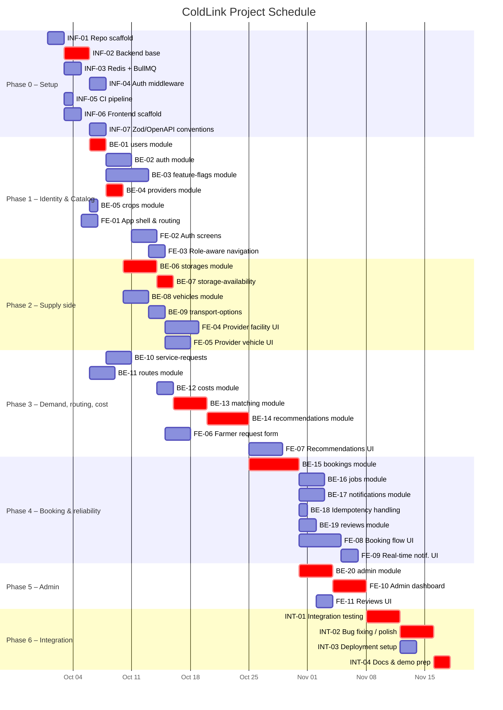
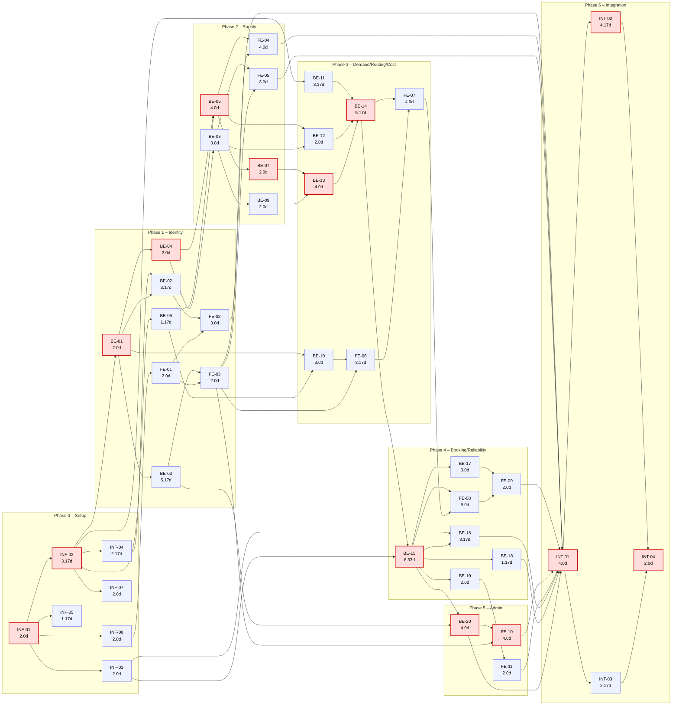

# ColdLink Project Schedule

Companion to `01`–`10`. This doc turns the module list in `01` into a schedulable task set: a Work Breakdown Structure, PERT time estimates, a Critical Path (CPM) analysis, a bar chart, an activity network, and the conventions any GitHub issue must follow to stay traceable back to this schedule.

**Team assumption:** at least 2 backend developers + 1–2 frontend developers (+ 1 person covering infra/integration, can double up). The critical path below is a *logical* dependency chain — it doesn't shrink with more people — but several non-critical branches run in parallel, so a team of ~4–5 can realistically hit this schedule; a solo developer should roughly sum every task instead (~150 person-days) and expect it to take much longer in wall-clock time.

## 1. Work Breakdown Structure (bottom-up, per module)

Each module in `01` is broken into one schedulable task, split by track. Where a module has real internal complexity (bookings, matching, recommendations, roles), it stays one task — further breakdown happens at the GitHub-issue level (§6), not here.

| Phase | Track | ID | Task | Depends on |
|---|---|---|---|---|
| 0 — Setup | Shared | `INF-01` | Repo scaffold, folder structure, lint/format | — |
| 0 | Shared | `INF-02` | Backend base: Express + TS + Drizzle + MariaDB connection | `INF-01` |
| 0 | Shared | `INF-03` | Redis + BullMQ base job runner | `INF-01` |
| 0 | Shared | `INF-04` | Auth middleware groundwork (JWT, password hashing) | `INF-02` |
| 0 | Shared | `INF-05` | CI pipeline (lint/test/build on push) | `INF-01` |
| 0 | Shared | `INF-06` | Frontend scaffold: React + TS + Tailwind + Axios + Socket.IO client | `INF-01` |
| 0 | Shared | `INF-07` | Zod validation + OpenAPI generation conventions | `INF-02` |
| 1 — Identity & Catalog | Backend | `BE-01` | `users` module | `INF-02` |
| 1 | Backend | `BE-02` | `auth` module | `BE-01`, `INF-04` |
| 1 | Backend | `BE-03` | `feature-flags` module (roles, `user_roles`, flag CRUD) | `BE-01` |
| 1 | Backend | `BE-04` | `providers` module | `BE-01` |
| 1 | Backend | `BE-05` | `crops` module | `INF-02` |
| 1 | Frontend | `FE-01` | App shell, routing, layout | `INF-06` |
| 1 | Frontend | `FE-02` | Auth screens (register/login) | `FE-01`, `BE-02` |
| 1 | Frontend | `FE-03` | Role-aware navigation (farmer/provider/admin) | `FE-01`, `BE-03` |
| 2 — Supply side | Backend | `BE-06` | `storages` module (facilities + `facility_crop_configs`) | `BE-04`, `BE-05` |
| 2 | Backend | `BE-07` | `storage-availability` module | `BE-06` |
| 2 | Backend | `BE-08` | `vehicles` module | `BE-04` |
| 2 | Backend | `BE-09` | `transport-options` module | `BE-08` |
| 2 | Frontend | `FE-04` | Provider facility-management UI | `FE-03`, `BE-06` |
| 2 | Frontend | `FE-05` | Provider vehicle-management UI | `FE-03`, `BE-08` |
| 3 — Demand, routing, cost | Backend | `BE-10` | `service-requests` module | `BE-01`, `BE-05` |
| 3 | Backend | `BE-11` | `routes` module (provider interface, OSRM + Google Maps) | `INF-02` |
| 3 | Backend | `BE-12` | `costs` module | `BE-06`, `BE-08` |
| 3 | Backend | `BE-13` | `matching` module | `BE-07`, `BE-09` |
| 3 | Backend | `BE-14` | `recommendations` module | `BE-11`, `BE-12`, `BE-13` |
| 3 | Frontend | `FE-06` | Farmer service-request form | `FE-03`, `BE-10` |
| 3 | Frontend | `FE-07` | Recommendations/results UI | `FE-06`, `BE-14` |
| 4 — Booking & reliability | Backend | `BE-15` | `bookings` module (capacity-safe pipeline, idempotency, TTL) | `BE-14`, `INF-03` |
| 4 | Backend | `BE-16` | `jobs` module (TTL sweep, pruning, async delivery, rating recalc) | `INF-03`, `BE-15` |
| 4 | Backend | `BE-17` | `notifications` module + Socket.IO | `BE-15` |
| 4 | Backend | `BE-18` | Idempotency-key handling | `BE-15` |
| 4 | Backend | `BE-19` | `reviews` module | `BE-15` |
| 4 | Frontend | `FE-08` | Booking flow + status-tracking UI | `FE-07`, `BE-15` |
| 4 | Frontend | `FE-09` | Real-time notifications UI | `FE-08`, `BE-17` |
| 5 — Admin | Backend | `BE-20` | `admin` module (monitoring, role/flag admin API) | `BE-15`, `BE-03` |
| 5 | Frontend | `FE-10` | Admin dashboard (roles, feature flags, monitoring) | `FE-03`, `BE-20` |
| 5 | Frontend | `FE-11` | Reviews UI | `BE-19` |
| 6 — Integration | Shared | `INT-01` | End-to-end integration testing | `FE-02`, `FE-04`, `FE-05`, `FE-09`, `FE-10`, `FE-11`, `BE-16`, `BE-18`, `BE-20` |
| 6 | Shared | `INT-02` | Bug fixing / polish | `INT-01` |
| 6 | Shared | `INT-03` | Deployment setup | `INT-01` |
| 6 | Shared | `INT-04` | Documentation & demo prep | `INT-02`, `INT-03` |

34 tasks total (7 infra, 20 backend, 11 frontend — `BE`/`FE` counts overlap phases; shared/integration counted once).

## 2. PERT time estimates (working days)

`TE = (O + 4M + P) / 6` — the standard PERT weighted average, favoring the most-likely estimate. Estimates assume one developer working the task alone, familiar with the stack decided in `00`/`04`.

| ID | O | M | P | TE |
|---|---|---|---|---|
| `INF-01` | 1 | 2 | 3 | 2.00 |
| `INF-02` | 2 | 3 | 5 | 3.17 |
| `INF-03` | 1 | 2 | 3 | 2.00 |
| `INF-04` | 1 | 2 | 4 | 2.17 |
| `INF-05` | 1 | 1 | 2 | 1.17 |
| `INF-06` | 1 | 2 | 3 | 2.00 |
| `INF-07` | 1 | 2 | 3 | 2.00 |
| `BE-01` | 1 | 2 | 3 | 2.00 |
| `BE-02` | 2 | 3 | 5 | 3.17 |
| `BE-03` | 3 | 5 | 8 | 5.17 |
| `BE-04` | 1 | 2 | 3 | 2.00 |
| `BE-05` | 1 | 1 | 2 | 1.17 |
| `BE-06` | 2 | 4 | 6 | 4.00 |
| `BE-07` | 1 | 2 | 3 | 2.00 |
| `BE-08` | 2 | 3 | 4 | 3.00 |
| `BE-09` | 1 | 2 | 3 | 2.00 |
| `BE-10` | 2 | 3 | 4 | 3.00 |
| `BE-11` | 2 | 3 | 5 | 3.17 |
| `BE-12` | 1 | 2 | 3 | 2.00 |
| `BE-13` | 2 | 4 | 6 | 4.00 |
| `BE-14` | 3 | 5 | 8 | 5.17 |
| `BE-15` | 4 | 6 | 10 | 6.33 |
| `BE-16` | 2 | 3 | 5 | 3.17 |
| `BE-17` | 2 | 3 | 4 | 3.00 |
| `BE-18` | 1 | 1 | 2 | 1.17 |
| `BE-19` | 1 | 2 | 3 | 2.00 |
| `BE-20` | 2 | 4 | 6 | 4.00 |
| `FE-01` | 1 | 2 | 3 | 2.00 |
| `FE-02` | 2 | 3 | 4 | 3.00 |
| `FE-03` | 1 | 2 | 3 | 2.00 |
| `FE-04` | 2 | 4 | 6 | 4.00 |
| `FE-05` | 2 | 3 | 4 | 3.00 |
| `FE-06` | 2 | 3 | 5 | 3.17 |
| `FE-07` | 2 | 4 | 6 | 4.00 |
| `FE-08` | 3 | 5 | 7 | 5.00 |
| `FE-09` | 1 | 2 | 3 | 2.00 |
| `FE-10` | 2 | 4 | 6 | 4.00 |
| `FE-11` | 1 | 2 | 3 | 2.00 |
| `INT-01` | 2 | 4 | 6 | 4.00 |
| `INT-02` | 2 | 4 | 7 | 4.17 |
| `INT-03` | 1 | 2 | 4 | 2.17 |
| `INT-04` | 1 | 2 | 3 | 2.00 |

The highest-variance tasks (`P − O` large relative to `TE`) are `BE-03`, `BE-14`, `BE-15` — the roles/feature-flags engine, the ranking pipeline, and the capacity-safe booking transaction. These are the ones most worth a design spike or pairing session before estimating harder, since they're also on or adjacent to the critical path below.

## 3. Sequencing & Critical Path (CPM)

Forward pass (Early Start/Finish) and backward pass (Late Start/Finish) computed on the dependency table in §1, using the exact `TE` values from §2.

| ID | ES | EF | LS | LF | Slack | Critical? |
|---|---|---|---|---|---|---|
| `INF-01` | 0.00 | 2.00 | 0.00 | 2.00 | 0.00 | ✅ |
| `INF-02` | 2.00 | 5.17 | 2.00 | 5.17 | 0.00 | ✅ |
| `INF-03` | 2.00 | 4.00 | 22.34 | 24.34 | 20.34 | |
| `INF-04` | 5.17 | 7.34 | 30.33 | 32.50 | 25.16 | |
| `INF-05` | 2.00 | 3.17 | 46.84 | 48.01 | 44.84 | |
| `INF-06` | 2.00 | 4.00 | 18.50 | 20.50 | 16.50 | |
| `INF-07` | 5.17 | 7.17 | 46.84 | 48.84 | 41.67 | |
| `BE-01` | 5.17 | 7.17 | 5.17 | 7.17 | 0.00 | ✅ |
| `BE-02` | 7.34 | 10.51 | 32.50 | 35.67 | 25.16 | |
| `BE-03` | 7.17 | 12.34 | 17.33 | 22.50 | 10.16 | |
| `BE-04` | 7.17 | 9.17 | 7.17 | 9.17 | 0.00 | ✅ |
| `BE-05` | 5.17 | 6.34 | 8.00 | 9.17 | 2.83 | |
| `BE-06` | 9.17 | 13.17 | 9.17 | 13.17 | 0.00 | ✅ |
| `BE-07` | 13.17 | 15.17 | 13.17 | 15.17 | 0.00 | ✅ |
| `BE-08` | 9.17 | 12.17 | 10.17 | 13.17 | 1.00 | |
| `BE-09` | 12.17 | 14.17 | 13.17 | 15.17 | 1.00 | |
| `BE-10` | 7.17 | 10.17 | 21.50 | 24.50 | 14.33 | |
| `BE-11` | 5.17 | 8.34 | 16.00 | 19.17 | 10.83 | |
| `BE-12` | 13.17 | 15.17 | 17.17 | 19.17 | 4.00 | |
| `BE-13` | 15.17 | 19.17 | 15.17 | 19.17 | 0.00 | ✅ |
| `BE-14` | 19.17 | 24.34 | 19.17 | 24.34 | 0.00 | ✅ |
| `BE-15` | 24.34 | 30.67 | 24.34 | 30.67 | 0.00 | ✅ |
| `BE-16` | 30.67 | 33.84 | 35.50 | 38.67 | 4.83 | |
| `BE-17` | 30.67 | 33.67 | 33.67 | 36.67 | 3.00 | |
| `BE-18` | 30.67 | 31.84 | 37.50 | 38.67 | 6.83 | |
| `BE-19` | 30.67 | 32.67 | 34.67 | 36.67 | 4.00 | |
| `BE-20` | 30.67 | 34.67 | 30.67 | 34.67 | 0.00 | ✅ |
| `FE-01` | 4.00 | 6.00 | 20.50 | 22.50 | 16.50 | |
| `FE-02` | 10.51 | 13.51 | 35.67 | 38.67 | 25.16 | |
| `FE-03` | 12.34 | 14.34 | 22.50 | 24.50 | 10.16 | |
| `FE-04` | 14.34 | 18.34 | 34.67 | 38.67 | 20.33 | |
| `FE-05` | 14.34 | 17.34 | 35.67 | 38.67 | 21.33 | |
| `FE-06` | 14.34 | 17.51 | 24.50 | 27.67 | 10.16 | |
| `FE-07` | 24.34 | 28.34 | 27.67 | 31.67 | 3.33 | |
| `FE-08` | 30.67 | 35.67 | 31.67 | 36.67 | 1.00 | |
| `FE-09` | 35.67 | 37.67 | 36.67 | 38.67 | 1.00 | |
| `FE-10` | 34.67 | 38.67 | 34.67 | 38.67 | 0.00 | ✅ |
| `FE-11` | 32.67 | 34.67 | 36.67 | 38.67 | 4.00 | |
| `INT-01` | 38.67 | 42.67 | 38.67 | 42.67 | 0.00 | ✅ |
| `INT-02` | 42.67 | 46.84 | 42.67 | 46.84 | 0.00 | ✅ |
| `INT-03` | 42.67 | 44.84 | 44.67 | 46.84 | 2.00 | |
| `INT-04` | 46.84 | 48.84 | 46.84 | 48.84 | 0.00 | ✅ |

### Critical path (zero slack — any delay here delays the whole project)
```text
INF-01 → INF-02 → BE-01 → BE-04 → BE-06 → BE-07 → BE-13 → BE-14 → BE-15 → BE-20 → FE-10 → INT-01 → INT-02 → INT-04
```
**Total duration: 48.84 working days ≈ 9.8 weeks** — fits inside your existing 12-week plan (`00`) with roughly 2 weeks of buffer, consistent with that plan's own Week 12 buffer.

Notably, the critical path runs almost entirely through **backend**: identity → providers → storages → storage-availability → matching → recommendations → bookings → admin, then only touches frontend once, at the **admin dashboard** (`FE-10`) — because `admin` (`BE-20`) is the last backend module gating integration, and its UI is the last frontend piece with zero slack. Everything else on the frontend side (`FE-02` auth screens, `FE-04`/`FE-05` provider UI, `FE-06`–`FE-09` farmer flow) has 10–25 days of slack — meaning frontend work can lag noticeably behind backend on those screens without threatening the deadline, **except** the admin dashboard, which should not be left for last despite feeling like a "just for admins" feature.

## 4. Bar chart (Gantt)

Rounded to whole days for readability; exact PERT values are in §2. Replace `2026-10-01` with your actual start date — everything else is relative.



## 5. Activity network (AON, critical path highlighted)


Red nodes = the 14-task critical path from §3. Everything else has float — useful for deciding what a team member picks up next when blocked, without touching the deadline.

## 6. GitHub issue conventions (read this before creating any issue)

Every issue — whether created by a person or by AI on someone's behalf — must stay traceable back to this schedule. Rules:

- **Title:** `[<TaskID>] <Task name>`, exactly as written in §1 — e.g. `[BE-06] storages module`. Never invent a new title style or drop the task ID; it's the permanent cross-reference key across this doc, commits (`07`), and the issue tracker.
- **Labels (apply all that fit):**
  - Track: `backend`, `frontend`, or `infra`/`integration`
  - Phase: `phase-0-setup` … `phase-6-integration` (matches §1)
  - `critical-path` — applied only to the 14 tasks marked ✅ in §3. This tells anyone triaging that slipping this issue slips the whole project.
- **Milestone:** one GitHub Milestone per phase (`Phase 0 – Setup`, `Phase 1 – Identity & Catalog`, …), due date = project start + that phase's last task's `EF` from §3 (round up).
- **Body template:**
  ```markdown
  **Module doc:** `01` §Modules (row for this module) — also see `05`/`06`/`10` as relevant
  **Depends on:** #<issue-of-each-predecessor-task-id>
  **Blocks:** #<issue-of-each-successor-task-id>   (fill in once those issues exist)
  **Estimate (PERT):** <TE from §2> days
  **Acceptance criteria:**
  - [ ] Schema/entities match `10` for this module's tables
  - [ ] Service-layer rules match `01`/`06` for this module
  - [ ] Endpoints match `05` exactly (path, method, no invented response shape)
  - [ ] <task-specific criteria>
  ```
- **Creation order:** create issues in the same topological order as §1/§5 (predecessors before successors) so `Depends on` links always point at an issue that already exists — never forward-reference an issue number that doesn't exist yet.
- **Status tracking:** a GitHub Project board's columns should mirror `09-feature-progress.md`'s status values exactly — `Not started` · `In progress` · `Partial` · `Done` · `Blocked` — so the board and that doc never drift into two different vocabularies for the same thing. `09` remains the source of truth for actual (code-inspected) progress; the board is a view over it, not a second ledger.
- **Never** split one WBS task across multiple issues, and never merge two WBS tasks into one issue, without first updating this doc — otherwise the dependency graph in §5 silently goes stale.

## 7. Notes & assumptions
- Estimates are working days for one developer at normal (non-crunch) pace; no holidays/weekends factored into the Gantt dates — adjust the calendar, not the durations.
- `INF-05` (CI) and `INF-07` (Zod/OpenAPI conventions) have very high slack (~42–45 days) — they don't block anything downstream in this graph, but skipping them isn't free; do them early anyway, cheaply, in parallel with `INF-02`.
- This schedule doesn't resource-level (it doesn't check whether your actual team has enough people to run every parallel branch at once) — if your team is smaller than assumed, non-critical tasks will start consuming their slack, which is fine up to the point a task's slack hits zero.
- If any critical-path task's real duration exceeds its `TE`, the whole project slips by the same amount — these 14 tasks are the ones worth a status check-in more often than the rest.

## 8. Approved addition: payment sandbox integration (#19)

The original WBS/PERT/CPM baseline predates the approved Payment module and does not include #19; do not treat its task count, estimates, or critical path as covering this work. The approved execution order is:

1. Verify `INF-01` complete (repository scaffold, folder structure, lint/format).
2. Verify `INF-02` complete (Express + TypeScript + Drizzle + MariaDB backend base; depends on `INF-01`).
3. Implement the Payment module, durable payment-attempt persistence, authenticated initiation/callback handling, idempotency, and sandbox-only configuration.
4. Implement bKash Tokenized Checkout without agreement and SSLCommerz Hosted Checkout adapters.
5. Complete automated tests and successful/failed sandbox roundtrips for both providers.

No estimate or CPM impact is assigned here; re-estimate if maintaining the original project schedule becomes necessary. INF-01 and INF-02 are schedule entries, not separate GitHub issues. Their completion must be verified from the actual repository before #19 implementation begins.
