# ColdLink V1 — Entity Relationship Diagram

> **Planning diagram, not a migration contract.** This diagram summarizes entities and relationships in `.ai/10-DB-SCHEMA.md` and accepted ADRs. The business schema is not implemented. Physical naming and some relationships remain open. Accepted ADRs supersede legacy draft details: for example, authorization is permission-based (not `users.role`), and service areas belong to vehicles (not providers). Payment-attempt ownership/obligation links and several workflow histories are intentionally not invented.

```mermaid
erDiagram
    USERS {
        CHAR36 id PK
        string full_name
        string email UK
        string phone "nullable, unique"
        string password_hash
        enum status
        datetime created_at
        datetime updated_at
        datetime last_login_at
        datetime email_verified_at
        datetime phone_verified_at
    }
    FARMER_PROFILES {
        CHAR36 user_id PK, FK
        datetime created_at
    }
    PROVIDER_PROFILES {
        CHAR36 user_id PK, FK
        string business_name
        string business_address
        string contact_person
        enum provider_status
        decimal average_rating
        int total_reviews
        enum installment_cadence
        int installment_cadence_custom_days
        enum admin_cadence_override
        int admin_cadence_override_custom_days
        decimal down_payment_pct
        decimal admin_down_payment_override_pct
        datetime created_at
        datetime updated_at
    }
    AUTH_SESSIONS {
        CHAR36 id PK
        CHAR36 user_id FK
        datetime created_at
        datetime last_used_at
        datetime revoked_at
    }
    AUTH_TOKENS {
        CHAR36 id PK
        CHAR36 user_id FK
        CHAR36 session_id FK "nullable"
        enum token_type
        string token_hash UK
        datetime expires_at
        datetime used_at
        datetime revoked_at
    }
    USER_CONTACT_HISTORY {
        CHAR36 id PK
        CHAR36 user_id FK
        enum contact_type
        string contact_value
        string normalized_value
        datetime verified_at
        datetime changed_at
    }
    ROLES {
        string role_key PK
        string name
        string description
        boolean is_system
        enum status
    }
    PERMISSIONS {
        string permission_key PK
        string description
    }
    USER_ROLES {
        CHAR36 user_id PK, FK
        string role_key PK, FK
        datetime assigned_at
    }
    ROLE_PERMISSIONS {
        string role_key PK, FK
        string permission_key PK, FK
    }
    USER_PERMISSION_ASSIGNMENTS {
        CHAR36 user_id PK, FK
        string permission_key PK, FK
        enum effect "ALLOW or DENY"
        datetime created_at
    }
    CROPS {
        CHAR36 id PK
        string name UK
        string category
        enum status
        string name_bn "deferred; outside V1"
    }
    QUANTITY_UNITS {
        CHAR36 id PK
        string code UK
        string display_name
        string quantity_dimension
        bigint to_base_numerator
        bigint to_base_denominator
    }
    CROP_QUANTITY_UNITS {
        CHAR36 crop_id PK, FK
        CHAR36 quantity_unit_id PK, FK
    }
    STORAGE_FACILITIES {
        CHAR36 id PK
        CHAR36 provider_id FK
        string name
        string address
        decimal latitude
        decimal longitude
        enum status
    }
    FACILITY_CROP_CONFIGS {
        CHAR36 id PK
        CHAR36 facility_id FK
        CHAR36 crop_id FK
        CHAR36 quantity_unit_id FK
        decimal max_capacity_for_crop
        decimal price_per_unit_per_day
        boolean is_available
        datetime created_at
        datetime updated_at
    }
    STORAGE_CAPACITY_ALLOCATIONS {
        CHAR36 id PK
        CHAR36 facility_crop_config_id FK
        CHAR36 storage_booking_id FK, UK
        decimal quantity
        CHAR36 quantity_unit_id FK
        date start_date
        date end_date
        enum status
    }
    VEHICLES {
        CHAR36 id PK
        CHAR36 provider_id FK
        string vehicle_type
        string registration_number UK
        decimal capacity
        CHAR36 capacity_unit_id FK
        decimal base_charge
        decimal cost_per_km
        enum status
    }
    VEHICLE_SERVICE_AREAS {
        CHAR36 id PK
        CHAR36 vehicle_id FK, UK
        string region_name
        decimal center_latitude
        decimal center_longitude
        decimal radius_km
        datetime created_at
    }
    FARM_LOCATIONS {
        CHAR36 id PK
        CHAR36 farmer_id FK
        string label
        string address
        decimal latitude
        decimal longitude
        boolean is_default
        enum status
        datetime created_at
    }
    VEHICLE_AVAILABILITY_BLOCKS {
        CHAR36 id PK
        CHAR36 vehicle_id FK
        CHAR36 transportation_booking_id FK, UK "nullable for manual block"
        datetime start_datetime
        datetime end_datetime
        enum status
        datetime created_at
        datetime updated_at
    }
    SERVICE_REQUESTS {
        CHAR36 id PK
        CHAR36 farmer_id FK
        CHAR36 crop_id FK
        CHAR36 quantity_unit_id FK
        CHAR36 farm_location_id FK
        decimal quantity
        enum service_type
        date storage_start_date
        date storage_end_date
        boolean needs_transportation
        datetime pickup_datetime
        string destination_address
        decimal destination_latitude
        decimal destination_longitude
        enum status
        datetime created_at
        datetime updated_at
    }
    RECOMMENDATIONS {
        CHAR36 id PK
        CHAR36 service_request_id FK
        CHAR36 facility_id FK "nullable"
        CHAR36 vehicle_id FK "nullable"
        decimal storage_cost
        decimal transport_cost
        decimal total_cost
        decimal distance_km
        int duration_min
        decimal available_capacity_snapshot
        decimal provider_rating_snapshot
        int rank_position
        datetime generated_at
        datetime expires_at
        enum status
    }
    BOOKINGS {
        CHAR36 id PK
        CHAR36 service_request_id FK
        CHAR36 farmer_id FK
        CHAR36 recommendation_id FK "nullable"
        enum booking_type
        enum overall_status
        decimal total_cost
        datetime expires_at
        datetime created_at
        datetime updated_at
        datetime cancelled_at
        string cancellation_reason
    }
    STORAGE_BOOKINGS {
        CHAR36 id PK
        CHAR36 booking_id FK, UK
        CHAR36 facility_crop_config_id FK
        decimal quantity
        CHAR36 quantity_unit_id FK
        date start_date
        date end_date
        decimal price_per_unit_snapshot
        decimal commission_rate_pct_snapshot
        decimal total_storage_cost
        enum installment_cadence_snapshot
        int installment_cadence_custom_days_snapshot
        decimal down_payment_pct_snapshot
        int installment_grace_days_snapshot
        int collection_notice_lead_days_snapshot
        enum status
        string rejection_reason
        datetime created_at
        datetime updated_at
    }
    TRANSPORTATION_BOOKINGS {
        CHAR36 id PK
        CHAR36 booking_id FK, UK
        CHAR36 vehicle_id FK
        decimal quantity
        CHAR36 quantity_unit_id FK
        string pickup_address
        string dropoff_address
        decimal distance_km
        int duration_min
        datetime scheduled_datetime
        decimal base_charge_snapshot
        decimal cost_per_km_snapshot
        decimal commission_rate_pct_snapshot
        decimal total_transport_cost
        enum status
        string rejection_reason
        datetime created_at
        datetime updated_at
    }
    REVIEWS {
        CHAR36 id PK
        CHAR36 farmer_id FK
        CHAR36 provider_id FK
        CHAR36 storage_booking_id FK, UK "nullable"
        CHAR36 transportation_booking_id FK, UK "nullable"
        int rating
        string review_text
        datetime created_at
    }
    BOOKING_STATUS_HISTORY {
        CHAR36 id PK
        enum entity_type
        CHAR36 entity_id "polymorphic, no FK"
        string previous_status
        string new_status
        CHAR36 changed_by FK "nullable"
        string reason
        datetime changed_at
    }
    NOTIFICATIONS {
        CHAR36 id PK
        CHAR36 recipient_user_id FK
        string notification_type
        string title
        string message
        string related_entity_type
        CHAR36 related_entity_id "polymorphic, no FK"
        boolean is_read
        datetime created_at
        datetime read_at
    }
    AUDIT_RECORDS {
        CHAR36 id PK
        string actor_type
        CHAR36 actor_user_id FK "nullable"
        string event_type
        string action_key
        string target_type
        CHAR36 target_id "polymorphic, no FK"
        string reason
        string correlation_id
        datetime created_at
        json before_state
        json after_state
    }
    FEATURE_FLAGS {
        CHAR36 id PK
        string flag_key UK
        string description
        boolean global_enabled
        datetime created_at
        datetime updated_at
    }
    FEATURE_FLAG_OVERRIDES {
        CHAR36 id PK
        string flag_key FK
        enum scope
        string scope_id "polymorphic, no FK"
        boolean enabled
        datetime created_at
        datetime updated_at
    }
    IDEMPOTENCY_KEYS {
        CHAR36 user_id PK, FK
        string idempotency_key PK
        string endpoint
        string request_hash
        enum status
        int response_status
        json response_body
        string endpoint
        datetime created_at
        datetime expires_at
    }
    PAYMENT_ATTEMPTS {
        CHAR36 id PK
        string merchant_reference
        enum provider
        string provider_reference
        bigint amount "integer poisha"
        string currency
        enum status
        datetime created_at
        datetime updated_at
        datetime initiated_at
        datetime completed_at
    }
    COMMISSION_SERVICE_RATES {
        enum service_capability PK
        decimal rate_pct
        CHAR36 updated_by FK
        datetime updated_at
    }
    PROVIDER_COMMISSION_EXCEPTIONS {
        CHAR36 provider_user_id PK, FK
        enum service_capability PK
        decimal rate_pct
        CHAR36 updated_by FK
        datetime updated_at
    }
    PLATFORM_SETTINGS {
        string setting_key PK
        json value_json
        CHAR36 updated_by FK "nullable"
        datetime updated_at
    }
    STORAGE_INSTALLMENTS {
        CHAR36 id PK
        CHAR36 storage_booking_id FK
        int installment_number
        enum kind
        date period_start
        date period_end
        date due_date
        bigint amount "integer poisha"
        enum status
        datetime paid_at
        CHAR36 collected_by FK "nullable"
        datetime waived_at
        CHAR36 waived_by FK "nullable"
        string waive_reason
        datetime created_at
        datetime updated_at
    }
    BOOKING_EXTENSION_REQUESTS {
        CHAR36 id PK
        CHAR36 storage_booking_id FK
        CHAR36 farmer_id FK
        date requested_end_date
        bigint additional_cost "integer poisha"
        enum status
        string provider_response_reason
        datetime responded_at
        datetime expires_at
        datetime created_at
        datetime updated_at
    }
    OVERSTAY_RECORDS {
        CHAR36 id PK
        CHAR36 storage_booking_id FK, UK
        date start_date
        date end_date
        bigint rate_per_day_snapshot
        decimal multiplier_snapshot
        int deemed_return_threshold_days_snapshot
        int days_elapsed
        bigint total_accrued
        enum status
        CHAR36 finalized_by FK "nullable"
        datetime finalized_at
        datetime created_at
        datetime updated_at
    }

    USERS ||--o| FARMER_PROFILES : has
    USERS ||--o| PROVIDER_PROFILES : has
    USERS ||--o{ AUTH_SESSIONS : owns
    USERS ||--o{ AUTH_TOKENS : receives
    AUTH_SESSIONS o|--o{ AUTH_TOKENS : groups
    USERS ||--o{ USER_CONTACT_HISTORY : preserves
    USERS ||--o{ USER_ROLES : assigned
    ROLES ||--o{ USER_ROLES : groups
    ROLES ||--o{ ROLE_PERMISSIONS : grants
    PERMISSIONS ||--o{ ROLE_PERMISSIONS : catalogues
    USERS ||--o{ USER_PERMISSION_ASSIGNMENTS : assigned
    PERMISSIONS ||--o{ USER_PERMISSION_ASSIGNMENTS : references
    PROVIDER_PROFILES ||--o{ STORAGE_FACILITIES : owns
    PROVIDER_PROFILES ||--o{ VEHICLES : owns
    STORAGE_FACILITIES ||--o{ FACILITY_CROP_CONFIGS : configures
    CROPS ||--o{ FACILITY_CROP_CONFIGS : supports
    CROPS ||--o{ CROP_QUANTITY_UNITS : allows
    QUANTITY_UNITS ||--o{ CROP_QUANTITY_UNITS : allowed_for
    CROP_QUANTITY_UNITS ||--o{ FACILITY_CROP_CONFIGS : constrains
    QUANTITY_UNITS ||--o{ FACILITY_CROP_CONFIGS : measures
    FACILITY_CROP_CONFIGS ||--o{ STORAGE_CAPACITY_ALLOCATIONS : reserves
    QUANTITY_UNITS ||--o{ STORAGE_CAPACITY_ALLOCATIONS : measures
    VEHICLES ||--o| VEHICLE_SERVICE_AREAS : serves_within
    VEHICLES ||--o{ VEHICLE_AVAILABILITY_BLOCKS : blocks
    FARMER_PROFILES ||--o{ FARM_LOCATIONS : owns
    QUANTITY_UNITS ||--o{ VEHICLES : capacity_unit
    FARMER_PROFILES ||--o{ SERVICE_REQUESTS : submits
    CROPS ||--o{ SERVICE_REQUESTS : requests
    CROP_QUANTITY_UNITS ||--o{ SERVICE_REQUESTS : constrains
    FARM_LOCATIONS ||--o{ SERVICE_REQUESTS : pickup_location
    SERVICE_REQUESTS ||--o{ RECOMMENDATIONS : yields
    STORAGE_FACILITIES o|--o{ RECOMMENDATIONS : optional_facility
    VEHICLES o|--o{ RECOMMENDATIONS : optional_vehicle
    SERVICE_REQUESTS ||--o{ BOOKINGS : commits
    FARMER_PROFILES ||--o{ BOOKINGS : owns
    RECOMMENDATIONS o|--o{ BOOKINGS : selected_by
    BOOKINGS ||--o| STORAGE_BOOKINGS : includes_storage
    BOOKINGS ||--o| TRANSPORTATION_BOOKINGS : includes_transport
    FACILITY_CROP_CONFIGS ||--o{ STORAGE_BOOKINGS : fulfills
    QUANTITY_UNITS ||--o{ STORAGE_BOOKINGS : measures
    VEHICLES ||--o{ TRANSPORTATION_BOOKINGS : fulfills
    QUANTITY_UNITS ||--o{ TRANSPORTATION_BOOKINGS : measures
    STORAGE_BOOKINGS ||--o| STORAGE_CAPACITY_ALLOCATIONS : consumes
    TRANSPORTATION_BOOKINGS o|--o| VEHICLE_AVAILABILITY_BLOCKS : occupies
    FARMER_PROFILES ||--o{ REVIEWS : writes
    PROVIDER_PROFILES ||--o{ REVIEWS : receives
    STORAGE_BOOKINGS o|--o| REVIEWS : rated_by
    TRANSPORTATION_BOOKINGS o|--o| REVIEWS : rated_by
    USERS o|--o{ BOOKING_STATUS_HISTORY : changes
    USERS ||--o{ NOTIFICATIONS : receives
    USERS o|--o{ AUDIT_RECORDS : acts
    FEATURE_FLAGS ||--o{ FEATURE_FLAG_OVERRIDES : has
    USERS ||--o{ IDEMPOTENCY_KEYS : keys
    USERS o|--o{ PLATFORM_SETTINGS : updates
    PROVIDER_PROFILES ||--o{ PROVIDER_COMMISSION_EXCEPTIONS : negotiates
    USERS ||--o{ PROVIDER_COMMISSION_EXCEPTIONS : updates
    USERS ||--o{ COMMISSION_SERVICE_RATES : updates
    STORAGE_BOOKINGS ||--o{ STORAGE_INSTALLMENTS : schedules
    USERS o|--o{ STORAGE_INSTALLMENTS : collects_or_waives
    STORAGE_BOOKINGS ||--o{ BOOKING_EXTENSION_REQUESTS : extends
    FARMER_PROFILES ||--o{ BOOKING_EXTENSION_REQUESTS : requests
    STORAGE_BOOKINGS ||--o| OVERSTAY_RECORDS : accrues
    USERS o|--o{ OVERSTAY_RECORDS : finalizes
```

### Reading notes

- `PK`, `FK`, and `UK` identify key constraints. Nullable optional relationships and polymorphic references are labeled in the entity attributes.
- The ERD uses the accepted vehicle-owned service-area concept from ADR-0002, even though the legacy draft in `10` still has a provider-owned table name.
- Role/permission entities reflect ADR-0003; `users.role` from the old draft is intentionally omitted because it is superseded. Permission-assignment physical table names/columns are conceptual where `10` has not selected them.
- Payment attempts intentionally have no owner or obligation edge: ADR-0006/#19 leaves those physical relationships unresolved. Audit's target, notification related-entity, booking-history target, and feature-override scope are polymorphic and not database FKs.
- Capability-application and resource-verification evidence/history, dispute/refund/ledger/settlement records, and other entities without an agreed physical shape are not fabricated here. Use the reconciliation document and owning ADRs for their confirmed behavior.
