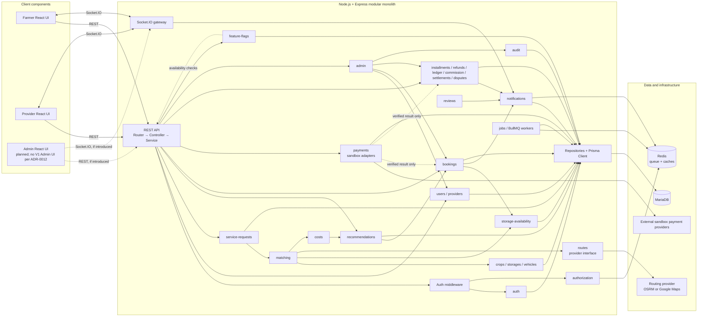

# ColdLink V1 — UML Component Diagram

> **Planned modular-monolith design.** The modules and dependency boundaries below come from `.ai/01-architecture.md` and `.ai/06-module-rules.md`; they do not imply implementation status.

### Ownership rules represented

- `matching` decides eligibility; `recommendations` ranks and persists results; `costs` owns formulas; `routes` alone calls the routing-provider interface.
- `bookings` owns lifecycle and delegates storage-capacity changes to `storages` / `storage-availability`. The capacity check and allocation writes share one transaction.
- `payments` owns sandbox initiation/callback verification. It reports verified facts to the domain owner and does not transition bookings or finance state itself.
- `admin` checks its explicit permission and delegates to the owning domain service; it does not bypass domain rules.
- Domain services submit required events to the single `audit` boundary. `jobs` owns deferred delivery and scheduled sweeps. Notification delivery goes through `notifications`.

| Component                                                                         | Responsibility                                                                                                                      |
| --------------------------------------------------------------------------------- | ----------------------------------------------------------------------------------------------------------------------------------- |
| `auth` / `authorization`                                                          | Session and identity validation; centralized permission resolution and ownership-aware access checks.                               |
| `service-requests`                                                                | Validate and persist the farmer's crop, quantity/unit, service type, dates, and location.                                           |
| `matching`                                                                        | Eligibility filtering for crop compatibility, full quantity, availability, vehicle suitability/service area, and route feasibility. |
| `storages` / `storage-availability` / `vehicles` / `transport-options`            | Own resource configuration and resource-specific capacity/availability/suitability operations.                                      |
| `routes` / `costs`                                                                | Obtain route facts through one provider interface; calculate storage, transport, and total prices.                                  |
| `recommendations`                                                                 | Rank feasible complete alternatives and persist expiring results.                                                                   |
| `bookings`                                                                        | Booking transitions and transactional capacity reservation, allocation, and release.                                                |
| `payments`                                                                        | Sandbox-only attempt initiation, provider adapters, callback correlation, and authoritative result verification.                    |
| `installments` / `refunds` / `ledger` / `commission` / `settlements` / `disputes` | Persist academic finance workflows and simulated outcomes; no live financial movement.                                              |
| `notifications` / `jobs`                                                          | Persist and deliver notifications; run scheduled sweeps and deferred work outside request handlers.                                 |
| `admin` / `audit` / `feature-flags`                                               | Permissioned admin entry points, centralized append-only audit boundary, and separate feature-availability evaluation.              |
