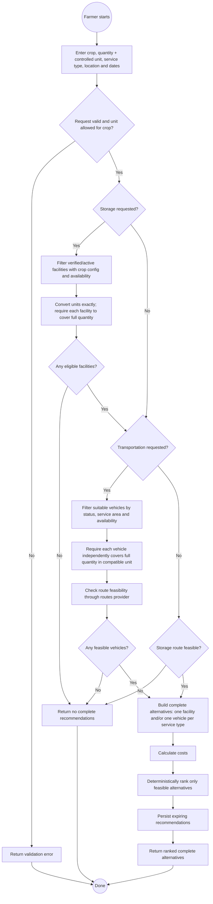
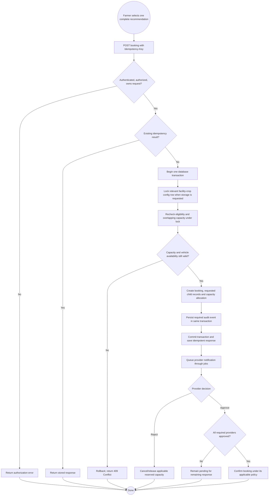
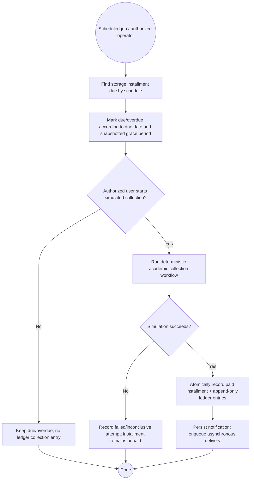

# ColdLink V1 — UML Activity Diagrams

> Mermaid activity-style flowcharts for the principal V1 flows. These describe approved/planned behavior, not implemented features. Expanded issue #15 lifecycle behavior is deferred; booking statuses remain the basic architecture/API set.

## A. Generate complete recommendations

## B. Create booking with capacity safety

**Storage payment branch:** for storage bookings with a non-zero down payment, ADR-0010 requires the simulated payment before confirmation and schedule creation. With a zero deposit, provider approval confirms directly. Collection is simulated; the payment adapter never changes booking or finance state itself. The detailed overall booking state machine remains bounded by ADR-0014 and issue #15's deferred scope.

## C. Process a due installment (academic simulation)

