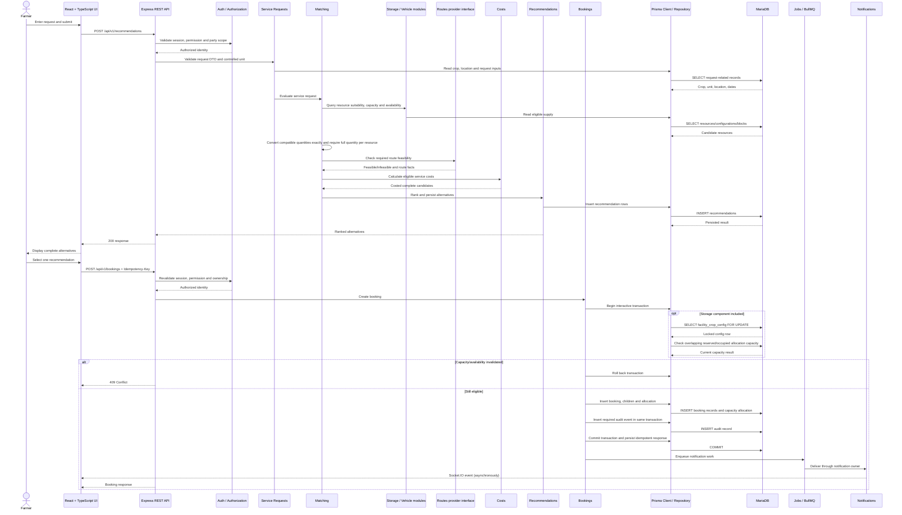
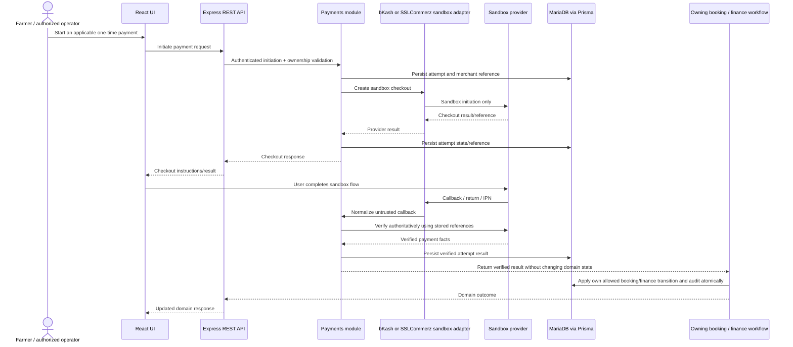

# ColdLink V1 — UML Sequence Diagrams

> Chronological interactions for the planned application. The main sequence shows recommendation retrieval and booking creation; the second shows a sandbox attempt boundary. No diagram implies live payment or completed implementation.

## A. Recommendation request and booking creation

## B. Sandbox payment attempt and domain update boundary

Payment-attempt ownership and obligation associations remain subject to ADR-0006/#19. The sequence deliberately does not draw a direct PaymentAttempt-to-Booking database relationship or allow a callback to transition booking/ledger state.
