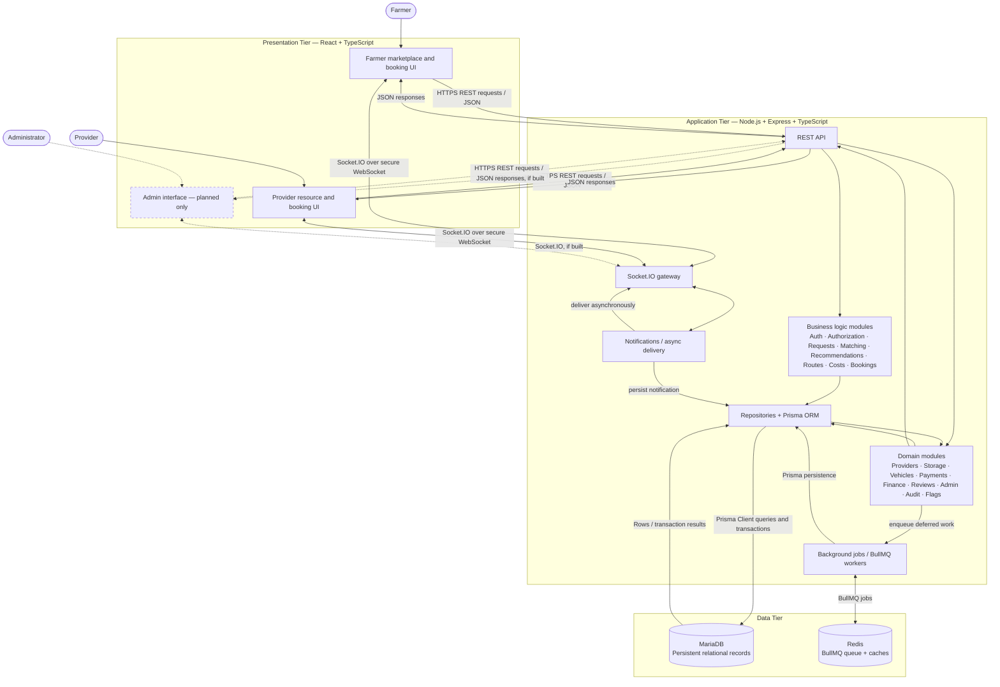

# ColdLink V1 — Three-Tier Architecture

## Communication and data flow

1. Farmers and providers use the React/TypeScript presentation tier. The administrator-facing UI is shown as planned: ADR-0012 specifies a backend Admin console but no V1 Admin UI.
2. The browser communicates with the Express application over REST for request/response work and Socket.IO for real-time notification delivery. The frontend never connects directly to MariaDB or Redis.
3. Express routes/controllers delegate to TypeScript business services. Those services enforce authentication/authorization and own workflow decisions such as eligibility, cost, booking, and capacity.
4. Repositories use Prisma ORM to read/write MariaDB. Multi-record booking/capacity operations use one transaction with the required capacity row lock.
5. Work that should not block the request is queued to BullMQ backed by Redis. Workers persist domain outcomes through module-owned services/repositories; notifications are persisted before asynchronous Socket.IO delivery.

> **Status:** This documents the approved target architecture. It does not claim that all tiers, modules, schemas, or workflows have been implemented.
